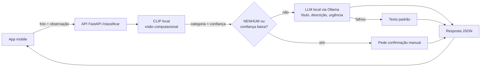

# Meu Bairro IA — classificação de problemas urbanos por foto

Global Solution 2026/2 · CitizenTech · Disruptive Architectures: IoT, IoB & Generative IA · FIAP

## Integrantes
- RM564227 — Vitor Augusto Oliveira de Abreu
- RM564662 — André Bellandi Vital Rodrigues
- RM563298 — Gabriel Garcia Mayo Delatore

## Funcionalidade
No app **Meu Bairro**, o morador tira a foto de um problema do bairro (buraco, poste, lixo, alagamento ou
calçada danificada). A IA identifica o tipo, sugere título, descrição e urgência, e o morador **confirma ou
edita** antes de enviar. Beneficiado: o morador. Contribuição: registros mais rápidos e padronizados para a
prefeitura.

## Arquitetura

**Fluxo de dados:** a foto é lida em memória, redimensionada e sem EXIF (inclusive GPS). Nada é gravado em disco.

Exemplo de resposta de `POST /classificar`:
```json
{
  "categoriaSugerida": "BURACO",
  "confianca": 0.91,
  "precisaConfirmar": false,
  "titulo": "Buraco na via",
  "descricao": "Buraco identificado na pista pela foto enviada.",
  "urgencia": "ALTA",
  "origemTexto": "llm",
  "aviso": "Sugestão gerada por IA. Confira e edite antes de enviar."
}
```

## Modelos e justificativas
| Etapa | Modelo | Por que |
|---|---|---|
| Visão computacional | `openai/clip-vit-base-patch32` (pré-treinado, zero-shot) | Não exige treino nem dataset rotulado grande, roda em CPU, e novas categorias exigem apenas novos prompts |
| IA generativa | `llama3.2:3b` via Ollama (local) | Gratuito, sem chave de API, bom em português e leve |

A visão produz fatos estruturados (tipo e confiança) e o LLM apenas redige a partir deles, o que reduz o risco
de alucinação. O aprofundamento escolhido é **Visão Computacional**. Tudo roda localmente: não há custo nem
credenciais no projeto.

## Como executar (Windows / PowerShell)
Requer Python 3.12 e o [Ollama](https://ollama.com).
```powershell
python -m venv .venv
.\.venv\Scripts\Activate.ps1
pip install torch --index-url https://download.pytorch.org/whl/cpu
pip install -r requirements.txt
ollama pull llama3.2:3b
uvicorn app.main:app --host 0.0.0.0 --port 8000
```
Documentação interativa em http://localhost:8000/docs. A primeira chamada baixa o CLIP (~600 MB).

## Testes automatizados
`python -m pytest` — 9 testes cobrindo tipo de arquivo inválido, imagem corrompida, arquivo grande demais, foto
sem problema, sucesso com LLM, baixa confiança, LLM offline e LLM com resposta inválida (usa texto padrão).

## Avaliação

### Dados
Conjunto de 33 imagens: 25 de problemas urbanos (5 buracos, 5 postes, 5 de lixo, 6 alagamentos e 4 calçadas) e
8 sem problema (`NENHUM`, incluindo casos difíceis). As fotos foram obtidas do Wikimedia Commons apenas com
licenças livres, de forma semiautomática (`eval/baixar_fotos.py`), e **revisadas manualmente**. Autor, licença
e link de cada foto estão em `eval/FONTES.csv`.

Para reproduzir:
```powershell
$env:COMMONS_CONTATO="seu-email@exemplo.com"
python -m eval.baixar_fotos --por-classe 6
python -m eval.avaliar --com-llm
python -m eval.degradar
python -m eval.avaliar --pasta dataset_robustez
```

### Resultado nas fotos originais
Acurácia de **84,8%** (28 de 33). Tempo médio de 0,7 s por imagem, em CPU.

| Categoria | Precisão | Recall | Imagens |
|---|---|---|---|
| BURACO | 0,67 | 0,80 | 5 |
| ILUMINACAO | 0,75 | 0,60 | 5 |
| LIXO | 0,80 | 0,80 | 5 |
| ALAGAMENTO | 0,86 | 1,00 | 6 |
| CALCADA | 1,00 | 1,00 | 4 |
| NENHUM | 1,00 | 0,88 | 8 |

Erros (5): dois postes (um classificado como buraco, 0,54, e outro como lixo, 0,68), um buraco como poste
(0,48), um lixo como alagamento (0,65) e uma foto sem problema classificada como buraco (0,51).
Calçada e alagamento foram as melhores categorias; iluminação foi a mais fraca (recall de 0,60).

### Teste de robustez (situações de falha)
Para cada uma das 25 fotos de problema geramos uma versão **borrada** (desfoque gaussiano, raio 6) e uma
**escura** (brilho em 25%), totalizando 50 imagens. A acurácia foi de **86,0%** (43 de 50), equivalente à das
fotos originais de problema (84,0%, 21 de 25).

Seis dos sete erros vieram de três fotos que já eram classificadas de forma incorreta na versão original; só um
erro foi causado exclusivamente pela degradação (um alagamento borrado classificado como lixo, com confiança
0,31). No nosso conjunto, o principal fator de erro é a ambiguidade da cena, não a qualidade da imagem. Os
testes usaram apenas um nível de desfoque e de escurecimento.

### Calibração da confiança
Com o limiar de 0,50, apenas 3 dos 12 erros somados (1 de 5 nas fotos originais e 2 de 7 nas degradadas) seriam
sinalizados para confirmação manual; os demais tiveram confiança entre 0,51 e 0,75. A confiança do CLIP não é
bem calibrada, o que justifica a **confirmação humana obrigatória** no app antes do envio.

### Geração de texto
O Llama 3.2 3B devolveu um JSON válido (título, descrição e urgência) em **15 de 15 chamadas (100%)**. A métrica
verifica apenas o formato da resposta, não a qualidade do texto, e o teste usou confiança fixa e nenhuma
observação do morador. Se o modelo estiver indisponível ou responder fora do formato, o serviço usa um texto
padrão (coberto por teste automatizado).

## Limitações
- O conjunto de teste é pequeno (33 imagens): cada erro altera a acurácia em cerca de 3 pontos percentuais, então os números são indicativos e não conclusivos.
- Fotos reais de moradores (câmera de celular, ângulos e iluminação variados) podem se comportar diferente das fotos do Commons.
- O CLIP zero-shot confunde cenas ambíguas, e a confiança não é bem calibrada.
- O LLM não enxerga a foto, apenas a categoria detectada: a descrição é genérica e a urgência pode estar errada. A urgência é só uma sugestão; a prioridade é decisão da prefeitura.
- Fotos com rostos ou placas de veículos podem ser enviadas pelo morador; elas não são armazenadas nem enviadas a terceiros, pois todo o processamento é local.

## Uso responsável
- A foto fica apenas em memória durante a requisição, sem EXIF/GPS e sem gravação em disco.
- Limite de 8 MB e apenas JPEG, PNG ou WebP.
- A observação do morador é tratada como dado (máximo de 300 caracteres), nunca como instrução ao modelo.
- A resposta traz o aviso de que a sugestão é gerada por IA e deve ser conferida pelo morador.
- Não há chaves de API nem credenciais no repositório.

## Uso de IA generativa no desenvolvimento
Claude (Anthropic) foi usado para gerar o esqueleto do projeto, os scripts de avaliação e os testes. O grupo
executou o projeto, revisou o conjunto de dados, avaliou os resultados e escreveu a análise. Os modelos que
compõem a solução são o CLIP (OpenAI) e o Llama 3.2 (Meta), ambos executados localmente.
